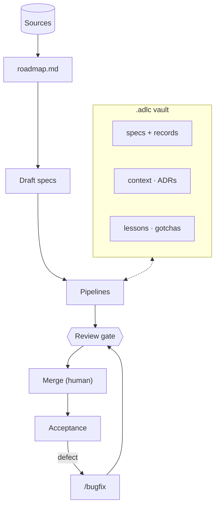

# Playbook — how {{PROJECT}} is built with ADLC

| Field | Value |
|---|---|
| Installed skills | {{SKILL_LIST}} |
| Related | [[plan/roadmap]] · [[plan/risk-register]] |

## Overview

One paragraph: source → roadmap → drafts → pick an item → pipeline → review → merge → acceptance → defects through `/bugfix`. Name the seams.

## Which pipeline for which work

| Kind of work | Pipeline | Gates | Why |
|---|---|---|---|
| Seams and high-risk work | `/proceed` | all human | … |
| Ordinary features | `/proceed` (or `/sprint` for several of your own ready items) | … | … |
| Low-risk, fully specified | `/autopilot` | … | … |
| Small or non-code | `/task` | two | … |
| Defects | `/bugfix` | … | … |
| Vault upkeep | `/status` · `/recover` · `/analyze` | — | … |

## Picking and claiming

- What is ready: `/roadmap next`.
- Start an item: `/spec pl-NNN` (or `/task`, `/proceed`, `/autopilot` with the same argument).
- Claim: …
- Release: …

## Definition of Ready

1. …

## Definition of Done

1. …

## Shared files

See [[plan/roadmap]] › Shared files.

## How it connects

## Team rules

1. …
