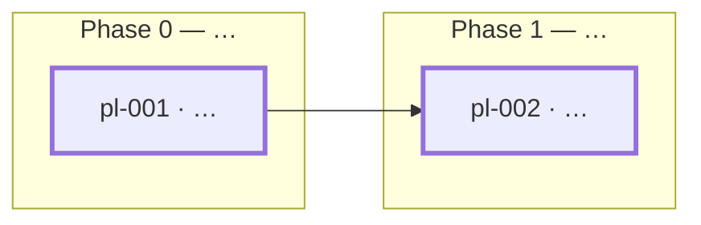

# Roadmap — {{PLAN_TITLE}}

| Field | Value |
|---|---|
| Plan | {{PLAN_SLUG}} |
| Sources | {{SOURCE_LIST}} |
| Items | {{ITEM_COUNT}} (`pl-001`…`pl-{{LAST}}`) |
| Ordering | by dependency — no dates |
| Companion files | [[plan/playbook]] · [[plan/risk-register]] · [[plan/gap-register]] |

> Written by `/roadmap`. Pipeline skills never edit this file: an item's progress is read from its draft's `Status`, its REQ's record, and the tracker.

## How source items became plan items

- **Default:** one plan item per source item.
- **Splits:** …
- **Merges:** …

### Not items

| Source item | What it is | Where it goes |
|---|---|---|
| … | … | … |

## Phases

| Phase | Purpose | Items | Effort |
|---|---|---|---|
| 0 | … | … | … |

## Items

Critical-path items are marked ●.

| Plan | Source | Title | Depends on | External gates | Tier | Risk | Effort | Run with |
|---|---|---|---|---|---|---|---|---|
| **Phase 0 — …** | | | | | | | | |
| [[pl-001-slug]] ● | … | … | — | … | … | … | … | … |

## Dependency graph

Edges added by inference (not stated in a source): …

**Critical path:** pl-001 → pl-002 → … (weighted by {{effort | item count}}).

What shortens it:

1. …

## Seams

| Seam | Item | Publishes | Lets these start against a stub |
|---|---|---|---|
| … | … | … | … |

## Shared files

| File or area | Why it is shared | Rule (interface first · run alone · through the seam) |
|---|---|---|
| … | … | … |

## External gates

| ID | Supplied by | Affects | Build against meanwhile |
|---|---|---|---|
| … | … | … | … |

## Go/no-go points

| Point | Passes when | If it fails |
|---|---|---|
| … | … | … |

## Source changes

| Change in the source | Effect on the plan |
|---|---|
| — | — |
